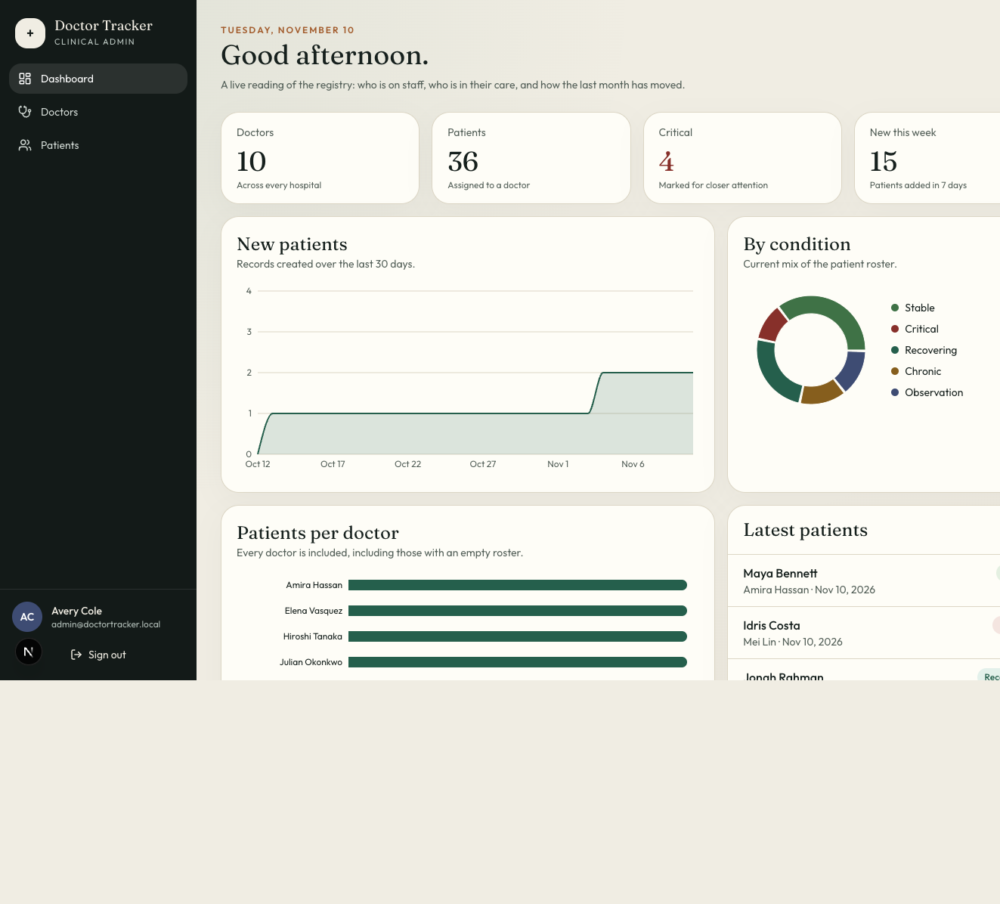
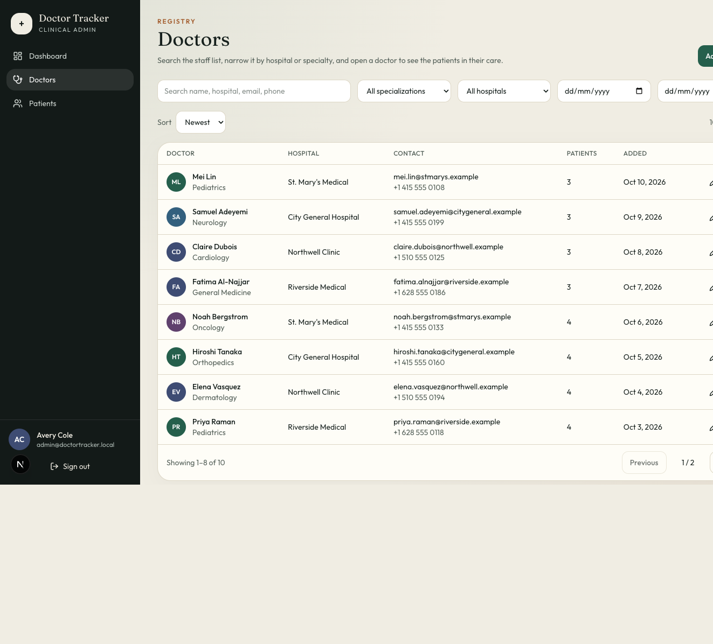
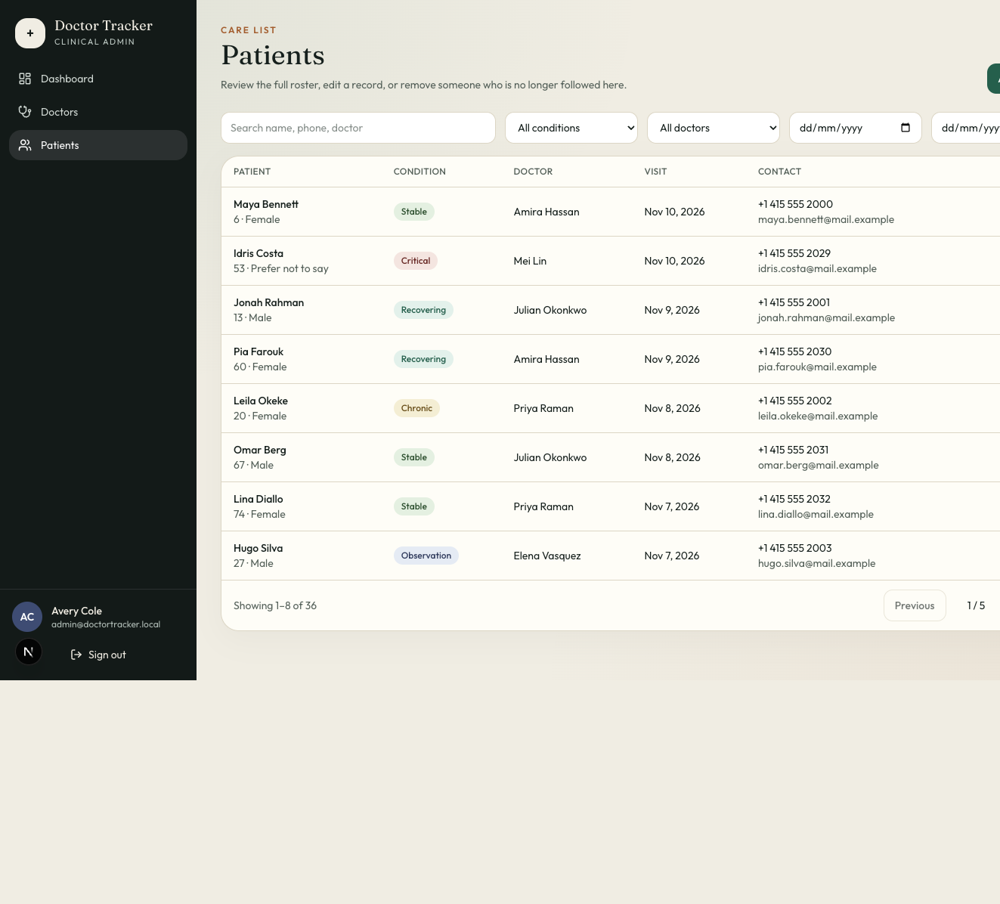

# Doctor Tracker

Doctor Tracker is a private clinic administration portal. Authenticated staff manage the doctor registry and the patients assigned to each doctor, then read the census through search, filters, and a dashboard built from live MongoDB aggregations. The Next.js client and the Express API are separate processes. The browser calls the API over REST.

## Features

- Cookie session login, with every page and API route closed to anonymous users
- Doctor records with name, specialization, hospital, phone, and email
- Search, specialization, hospital, and date filters, plus pagination
- A doctor profile with that doctor's patient roster
- Patient records with condition, visit date, and the assigned doctor
- Search, condition, doctor, and visit-date filters, plus pagination
- Edit and delete for both records. A doctor with patients cannot be deleted until the roster is cleared
- Dashboard totals, a 30-day intake chart, condition mix, and patients per doctor

## Setup

Requirements: Node.js 20 or newer. The API starts a portable MongoDB for the demo, so a separate database install is not required. The first launch downloads the database program. Data is kept in `server/data`.

```bash
cp .env.example .env.local
npm install
npm install --prefix frontend
npm install --prefix server
npm run dev
```

The Next.js app lives in `frontend/` and the Express API lives in `server/`. Both read `.env.local` from the repository root. The web app opens at [http://127.0.0.1:3000](http://127.0.0.1:3000). If that port is already taken, Next prints the port it used. The API listens at [http://127.0.0.1:4000](http://127.0.0.1:4000). In development the API accepts either localhost or 127.0.0.1.

| Variable | Purpose |
| --- | --- |
| `MONGODB_URI` | External MongoDB connection string. Leave unset to use the portable demo database |
| `AUTH_SECRET` | HMAC secret for session tokens. At least 32 characters |
| `ADMIN_NAME` | Display name created by the seed |
| `ADMIN_EMAIL` | Administrator email |
| `ADMIN_PASSWORD` | Administrator password. Re-running the seed resets it |
| `SHOW_DEMO_LOGIN` | Shows the reviewer account on the sign-in screen. Set to `false` in production |
| `PORT` | Express listen port |
| `CLINIC_TIMEZONE` | IANA timezone for "added on" filters and the intake chart. Defaults to the server timezone |
| `TRUST_PROXY` | Set to `1` only when one reverse proxy sits in front of the API |
| `CLIENT_ORIGIN` | Comma-separated Next.js origins allowed by CORS |
| `NEXT_PUBLIC_API_URL` | Express base URL used by the browser |

The first API launch creates the administrator and, when the doctors collection is empty, 10 doctors and 36 patients. `npm run seed` does the same again and resets the administrator password. Reviewer credentials from `.env.example`:

- Email: `admin@doctortracker.local`
- Password: `ChangeMe123!`

Production:

```bash
npm run build
npm start
```

`npm start` runs the Express API and the Next.js server together.

Set `SHOW_DEMO_LOGIN=false` and replace `AUTH_SECRET` and the administrator password before deploying.

## System architecture

```text
Browser (Next.js client, port 3000)
    │  fetch REST with credentials
    ▼
Express API (port 4000)
    │  CORS, httpOnly JWT cookie, Zod, indexed queries
    ▼
Portable MongoDB (started by the API)  users · doctors · patients
```

Next.js renders the screens and never opens MongoDB. Every read and write goes to Express. The session cookie is set by the API, so the shell waits for `GET /api/auth/me` before it shows a protected page. Filters live in the URL. Lists are paginated in Express. The dashboard calls `/api/stats`, which aggregates in MongoDB and returns the chart series.

Indexes follow the filters:

- Doctors: email (unique), name, created date, specialization + date, hospital + date
- Patients: doctor + visit date, condition + visit date, visit date, created date, name

Indexes are declared on the Mongoose schemas and synchronized once per process at connection time.

## Technical decisions

**A standalone Express server, with Next.js only as the client.** The brief asks for a separate Node/Express API and a separate Next.js application that talk over REST. Express owns validation, indexes, auth, and MongoDB. The React app imports none of that. The two processes can be deployed and scaled on their own.

**An httpOnly JWT cookie on the API, instead of a token in localStorage.** Express signs the session with `jose` and sets `dt_session` as an httpOnly cookie. The browser sends it with `credentials: "include"`. Page JavaScript cannot read it. Redux is not used because the source of truth is the API. Screens keep the current query, the open dialog, and the latest response.

## API

| Method | Path | Purpose |
| --- | --- | --- |
| `POST` | `/api/auth/login` | Sign in. Rate limited |
| `POST` | `/api/auth/logout` | Clear the session cookie |
| `GET` | `/api/auth/me` | Current administrator |
| `GET` | `/api/doctors` | Search, filter, paginate |
| `POST` | `/api/doctors` | Create a doctor |
| `GET` | `/api/doctors/:id` | One doctor, with patient count |
| `PATCH` | `/api/doctors/:id` | Update a doctor |
| `DELETE` | `/api/doctors/:id` | Delete only when the roster is empty |
| `GET` | `/api/patients` | Search, filter, paginate |
| `POST` | `/api/patients` | Create a patient under a doctor |
| `PATCH` | `/api/patients/:id` | Update a patient, including reassignment |
| `DELETE` | `/api/patients/:id` | Remove a patient |
| `GET` | `/api/stats` | Dashboard aggregations |
| `GET` | `/api/meta` | Filter options and the doctor picker |

List responses are `{ ok, data, page, limit, total, pages }`. Failures are `{ ok: false, error, code, fields }`.

## Project layout

```text
frontend/             Next.js application
  app/                pages
  components/ui       buttons, fields, dialogs, and badges
  components/layout  shell and toasts
  components/auth    sign-in form
  components/doctors doctor list, add and edit pages, detail, and form
  components/patients patient list, add and edit pages, and form
  components/dashboard census screen and charts
  lib/                browser API client and form validation
server/               Express application
  src/routes          HTTP paths
  src/controllers     request and response
  src/services        business rules and queries
  src/middleware      auth, validation, and the error handler
  src/errors          typed HTTP errors
  src/models          Mongoose schemas
```

## Visual evidence

Desktop captures of the running portal. Below 1024px the sidebar becomes a menu and the census cards stack.






